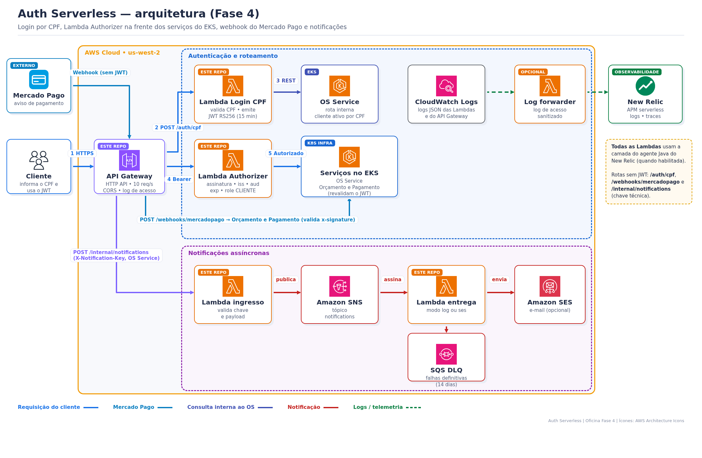
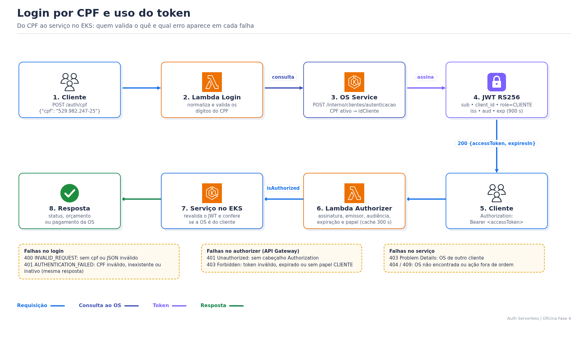
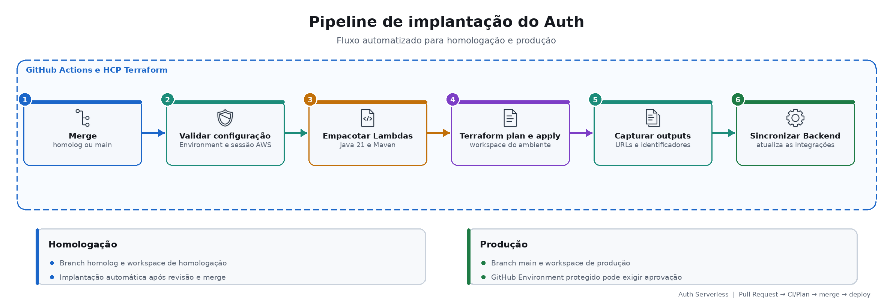

# Oficina Fase 4 — Auth Serverless

Porta de entrada pública da Oficina: **login do cliente por CPF**, **Lambda Authorizer JWT** na frente dos serviços do EKS, **API Gateway** com as rotas do cliente e do webhook do Mercado Pago, e **notificações assíncronas** (SNS → Lambda → SES/log, com DLQ).

> Documentação central da Fase 4: [oficina-os-service](https://github.com/tiagomiele/oficina-os-service). Este README cobre só o Auth Serverless.

## 1. Objetivo de negócio

- O cliente acompanha a OS, aprova ou rejeita o orçamento e paga **sem senha**: informa o CPF e recebe um token de 15 minutos.
- Só cliente **ativo** e com **CPF válido** entra; a resposta de recusa é única, então ninguém descobre quais CPFs são clientes.
- Os serviços no EKS só recebem chamadas de cliente com token válido.
- O Mercado Pago tem uma URL pública estável (`/webhooks/mercadopago`) para avisar pagamentos.
- E-mails ao cliente não travam a OS: são enfileirados e reprocessados; falhas definitivas ficam na DLQ.

## 2. Requisitos atendidos

**Funcionais**

| # | Requisito | Onde no código |
|---|---|---|
| RF1 | Login por CPF com ou sem máscara, com validação dos dígitos | `domain/Cpf.java`, `handler/CpfAuthenticationHandler.java` |
| RF2 | Só cliente ativo com documento CPF autentica (consulta ao OS Service, sem acesso ao banco) | `adapter/out/http/OsServiceClientRepository.java` |
| RF3 | Token JWT RS256 com `sub`, `client_id`, `role=CLIENTE`, `iss`, `aud`, `exp`, `jti` | `adapter/out/jwt/JwtTokenAdapter.java` |
| RF4 | Rotas do cliente protegidas pelo authorizer | `handler/JwtAuthorizerHandler.java`, `apigateway.tf` |
| RF5 | Rotas do cliente repassadas ao OS Service e ao Orçamento e Pagamento | `apigateway.tf` (`backend_route_keys`, `orcamento_pagamento_route_keys`) |
| RF6 | Webhook público do Mercado Pago repassado ao Orçamento e Pagamento | `apigateway.tf` (`mercadopago_webhook`) |
| RF7 | Notificação técnica aceita com chave e entregue de forma assíncrona | `handler/NotificationIngressHandler.java`, `NotificationDeliveryHandler.java`, `notification.tf` |

**Técnicos**

| Requisito | Como |
|---|---|
| Sem enumeração de clientes | 401 `AUTHENTICATION_FAILED` igual para CPF inválido, inexistente ou inativo |
| Sem PII em logs | CPF, token, destinatário e corpo nunca são logados (`observability/LogSanitizer.java`, `forwarder/AccessLogSanitizer.java`) |
| Chave privada só no login | o authorizer e os serviços recebem só a chave pública |
| Comparação segura da chave técnica | `MessageDigest.isEqual` no ingresso de notificações |
| Correlação | `X-Request-Id` do cliente ou `requestId` do API Gateway, repassado ao EKS e aos logs |
| Proteção contra abuso | throttling 10 req/s, rajada 20; cache do authorizer 300 s |
| Cold start dentro do limite | login e authorizer com 1024 MB (limites de 15 s e 10 s do API Gateway) |
| Clean Architecture | `domain` → `application` (portas) → `adapter/out` e `handler`; validado por ArchUnit (`CleanArchitectureTest`) |
| AWS Academy | todas as Lambdas usam a `LabRole`; SES opcional (`notification_delivery_mode=log`) |

## 3. Stack técnica

| Área | Tecnologias |
|---|---|
| Código | Java 21, Maven Wrapper, AWS Lambda Java Core/Events, Jackson |
| Segurança | JJWT 0.12 (RS256), Lambda Authorizer REQUEST (payload 2.0, respostas simples) |
| AWS | API Gateway HTTP API v2, Lambda `java21` arm64, SNS, SQS (DLQ), SES, CloudWatch Logs; `java.net.http.HttpClient` para consultar o OS Service |
| Infraestrutura | Terraform + HCP Terraform (workspaces `homolog` e `production`) |
| Qualidade | JUnit 5, ArchUnit, Spotless, TFLint, Trivy, Gitleaks, actionlint |
| Observabilidade | logs JSON, camada New Relic Java (ARM64), log forwarder do API Gateway para o New Relic |

## 4. Arquitetura



| Lambda | Handler | Memória / timeout | Função |
|---|---|---|---|
| `oficina-auth-<env>-login` | `CpfAuthenticationHandler` | 1024 MB / 15 s (na VPC) | valida o CPF, consulta o cliente no OS Service por REST e emite o JWT |
| `oficina-auth-<env>-authorizer` | `JwtAuthorizerHandler` | 1024 MB / 10 s | valida o token e devolve `isAuthorized` com `subject`, `clientId`, `role`, `requestId` |
| `oficina-auth-<env>-notification-ingress` | `NotificationIngressHandler` | 512 MB / 18 s | valida a chave e o payload e publica no SNS |
| `oficina-auth-<env>-notification-delivery` | `NotificationDeliveryHandler` | 384 MB / 30 s | entrega por SES ou só registra (modo `log`) |
| `oficina-auth-<env>-log-forwarder` (opcional) | `ApiGatewayLogForwarderHandler` | 384 MB / 30 s | envia o log de acesso sanitizado ao New Relic |

### Login e uso do token



## 5. Rotas do API Gateway

Contrato completo, com schemas, exemplos e erros: [docs/openapi/oficina-auth.yaml](docs/openapi/oficina-auth.yaml). Para visualizar, abra o arquivo em https://editor.swagger.io (File → Import file).

| Rota | Proteção | Destino |
|---|---|---|
| `POST /auth/cpf` | pública | Lambda Login |
| `GET /consulta/ordens-servico/{numeroOs}/status` | JWT | OS Service |
| `GET /ordens-servico/{numeroOs}/historico` | JWT | OS Service |
| `GET /orcamentos/{numeroOs}` | JWT | Orçamento e Pagamento |
| `POST /orcamentos/{numeroOs}/aprovar` | JWT | Orçamento e Pagamento |
| `POST /orcamentos/{numeroOs}/rejeitar` | JWT | Orçamento e Pagamento |
| `GET /pagamentos/{numeroOs}` | JWT | Orçamento e Pagamento |
| `POST /pagamentos/{numeroOs}/nova-tentativa` | JWT | Orçamento e Pagamento |
| `POST /webhooks/mercadopago` | assinatura `x-signature` (no serviço) | Orçamento e Pagamento |
| `POST /internal/notifications` | `X-Notification-Key` | Lambda ingresso |

As rotas para o EKS só existem quando `backend_base_url` e `orcamento_pagamento_base_url` estão preenchidas (o `configure-environment.ps1` do OS Service grava as URLs dos Load Balancers no workspace).

**Erros**

| HTTP | Corpo | Quando |
|---|---|---|
| 400 | `{"code":"INVALID_REQUEST",...}` | login sem `cpf`/JSON inválido; notificação com payload inválido |
| 401 | `{"code":"AUTHENTICATION_FAILED",...}` | CPF inválido, inexistente ou inativo |
| 401 | `{"message":"Unauthorized"}` | rota protegida sem `Authorization` |
| 403 | `{"message":"Forbidden"}` | token inválido, expirado, de outro emissor/audiência ou sem papel `CLIENTE` |
| 403/404/409 | Problem Details | resposta do serviço (OS de outro cliente, não encontrada, ação fora de ordem) |
| 429 | `{"message":"Too Many Requests"}` | acima de 10 req/s |
| 500 | `{"code":"INTERNAL_ERROR",...}` | falha interna do login (ex. banco fora) |
| 503 | `{"code":"SERVICE_UNAVAILABLE",...}` | falha ao publicar a notificação no SNS |

### Testar no PowerShell

```powershell
$api = gh variable get API_GATEWAY_BASE_URL --env production --repo tiagomiele/oficina-os-service
$login = Invoke-RestMethod -Method Post -Uri "$api/auth/cpf" -ContentType 'application/json' -Body '{"cpf":"<CPF de um cliente ativo>"}'
$h = @{ Authorization = "Bearer $($login.accessToken)" }
Invoke-RestMethod -Uri "$api/consulta/ordens-servico/OS-102026-000003/status" -Headers $h
Invoke-RestMethod -Uri "$api/orcamentos/OS-102026-000003" -Headers $h
```

Troque `<CPF de um cliente ativo>` pelo CPF cadastrado no OS Service, sem os sinais `< >`. Use `--env homolog` para homologação.

## 6. Banco de dados

O Auth **não tem banco e não acessa o banco de nenhum serviço**. Para saber se o CPF é de um cliente ativo, a Lambda Login chama a rota interna do OS Service, que é o dono da tabela `clientes`:

```http
POST <backend_base_url>/interno/clientes/autenticacao
X-Api-Key: <notification_api_key>
Content-Type: application/json

{"cpf":"52998224725"}
```

| Resposta do OS | Resultado do login |
|---|---|
| `200 {"idCliente": 1}` | emite o JWT com `sub = 1` |
| `404` (CPF inválido, inexistente ou inativo) | `401 AUTHENTICATION_FAILED` |
| outro status, timeout ou `backend_base_url` vazia | `500 INTERNAL_ERROR` |

Código: [`OsServiceClientRepository`](src/main/java/br/com/oficina/auth/adapter/out/http/OsServiceClientRepository.java). Para ver os clientes cadastrados, siga a seção de acesso ao banco do [Database Infra](https://github.com/tiagomiele/oficina-database-infra#readme).

## 7. Executar e validar localmente

Pré-requisitos: Java 21, Terraform e Python 3. Nada é criado na AWS.

```powershell
.\mvnw.cmd -B clean verify spotless:check
terraform fmt -check -recursive
terraform init -backend=false -input=false -lockfile=readonly
terraform validate
python -m unittest tests/test_sync_auth_outputs.py
```

O JAR das Lambdas fica em `target/oficina-auth.jar`.

## 8. Configuração

Exemplos: [homolog](environments/homolog.tfvars.example) e [production](environments/production.tfvars.example). Os valores sensíveis ficam no HCP Terraform e são gravados pelo `configure-environment.ps1` do OS Service.

| Variável Terraform | Uso |
|---|---|
| `jwt_private_key` (sensível) | assinatura do token (só Login) |
| `jwt_public_key` | authorizer; a mesma chave vai para `SERVERLESS_JWT_PUBLIC_KEY` dos serviços |
| `jwt_issuer` / `jwt_audience` / `jwt_ttl_seconds` | `oficina-auth-serverless` / `oficina-backend` / `900` |
| `private_subnet_ids`, `lambda_security_group_id` | VPC da Lambda Login (saída pela NAT) |
| `backend_base_url`, `orcamento_pagamento_base_url` | Load Balancers do EKS; nulas = só `/auth/cpf`. `backend_base_url` também vira `OS_SERVICE_BASE_URL` da Lambda Login |
| `notification_api_key` (sensível), `notification_delivery_mode` | chave técnica compartilhada com o OS Service (notificações e `X-Api-Key` da consulta do cliente, `INTERNAL_API_KEY`); `log` ou `ses` |
| `newrelic_instrumentation_enabled`, `newrelic_license_key`, `newrelic_account_id`, `newrelic_log_forwarding_enabled` | observabilidade |

## 9. CI/CD



| Workflow | Quando | O que faz |
|---|---|---|
| `ci.yml` | PR e push | actionlint, teste do sync, `mvnw verify spotless:check` (JUnit + ArchUnit), `terraform fmt/validate`, TFLint, Trivy, Gitleaks |
| `terraform-plan.yml` | PR para `homolog`/`main` | empacota e roda `terraform plan` no workspace do ambiente |
| `terraform-deploy.yml` | push em `homolog` (homologação) ou `main` (produção) | valida a sessão AWS Academy, empacota, `terraform apply` e roda `scripts/sync-auth-outputs.py` |

O sync grava `API_GATEWAY_BASE_URL`, `AUTH_BASE_URL` e `NOTIFICATION_ENDPOINT` no GitHub Environment do `oficina-os-service`. O deploy exige `TF_APPLY_ENABLED=true` no Environment.

**Outputs:** `api_base_url`, `cpf_authentication_url`, `mercadopago_webhook_url` (cole no painel do Mercado Pago), `notification_endpoint`, `notification_topic_arn`, `notification_dlq_url`, `login_lambda_name`, `authorizer_lambda_name`, `api_access_log_group`, `newrelic_instrumentation`.

## 10. Observabilidade

- **Logs JSON** em CloudWatch (`/aws/lambda/oficina-auth-<env>-*`, retenção 7 dias), com `function`, `outcome` (`SUCCESS`, `DENIED`, `ALLOW`, `DENY`, `ACCEPTED`...), `requestId`, duração e código de erro. Sem CPF, token ou e-mail.
- **Log de acesso** do API Gateway em `/aws/apigateway/oficina-auth-<env>`: rota, status, latência, erro de integração e do authorizer.
- **New Relic:** com `newrelic_instrumentation_enabled=true`, a camada `NewRelicAgentJavaARM64-slim` instrumenta as Lambdas (APM serverless, distributed tracing, atributos `auth.outcome` e `authorization.outcome`). Com `newrelic_log_forwarding_enabled=true`, o log de acesso vai para o New Relic com `logtype=api-gateway-access`.
- Dashboard e alertas: [oficina-kubernetes-infra](https://github.com/tiagomiele/oficina-kubernetes-infra).

```powershell
aws logs tail /aws/lambda/oficina-auth-production-login --since 15m --region us-west-2
aws logs tail /aws/lambda/oficina-auth-production-authorizer --since 15m --region us-west-2
aws logs tail /aws/apigateway/oficina-auth-production --since 15m --region us-west-2
aws sqs get-queue-attributes --queue-url (aws sqs get-queue-url --queue-name oficina-auth-production-notification-dlq --region us-west-2 --query QueueUrl --output text) --attribute-names ApproximateNumberOfMessages --region us-west-2
```

## 11. Repositórios da Fase 4

| Repositório | Papel |
|---|---|
| [oficina-os-service](https://github.com/tiagomiele/oficina-os-service) | OS, orquestração da Saga e documentação central |
| [oficina-orcamento-pagamento-service](https://github.com/tiagomiele/oficina-orcamento-pagamento-service) | orçamento, pagamento e Mercado Pago |
| [oficina-diagnostico-reparo-service](https://github.com/tiagomiele/oficina-diagnostico-reparo-service) | fila do técnico, diagnóstico e reparo |
| [oficina-database-infra](https://github.com/tiagomiele/oficina-database-infra) | RDS, DynamoDB, SQS e DLQs |
| [oficina-kubernetes-infra](https://github.com/tiagomiele/oficina-kubernetes-infra) | EKS e New Relic |

Base histórica: [Fase 3 — Auth Serverless](https://github.com/tiagomiele/fiap-tech-challenge-fase3-oficina-auth-serverless).

## Licença

[LICENSE](LICENSE)
